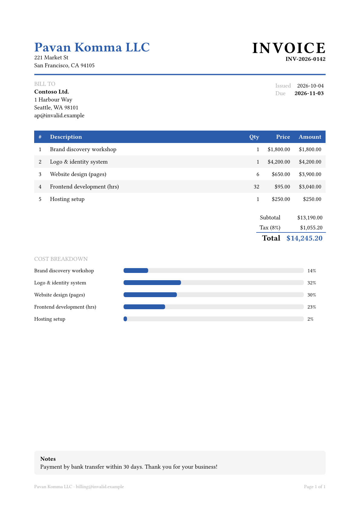
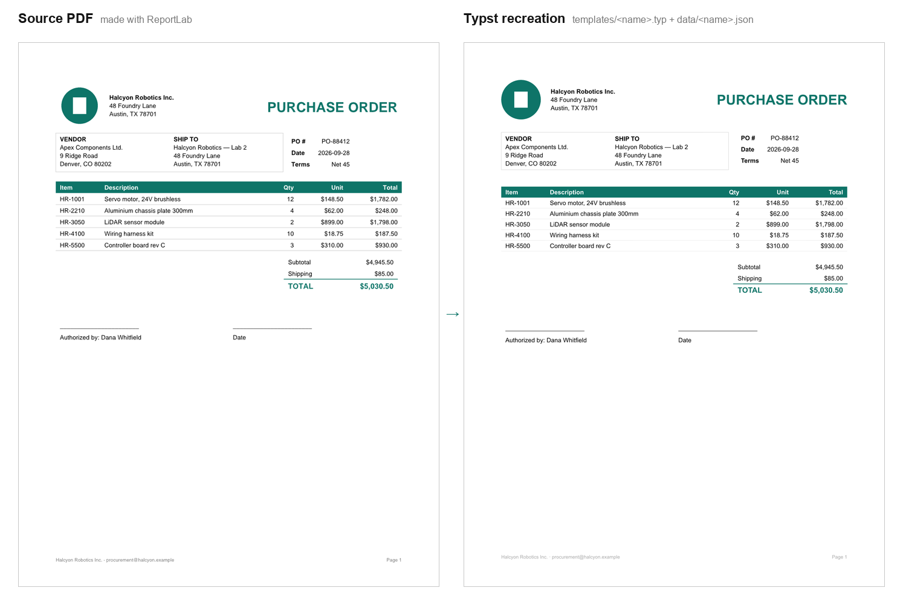

# TemplateEngine

Turn a **Typst template** and a **JSON file** into a **PDF** with one command.

```sh
tmpl templates/invoice.typ data/invoice.json invoice.pdf
```

<p align="center">
  <a href="docs/invoice-sample.pdf">
    
  </a>
  <br>
  <sub>Sample output: <a href="docs/invoice-sample.pdf">docs/invoice-sample.pdf</a></sub>
</p>

## How it works

```
data.json ──► tmpl (checks the JSON) ──► typst compile ──► out.pdf
                                            ▲
template.typ ───────────────────────────────┘
```

`tmpl` reads your JSON, makes sure it parses, and passes it to Typst as
`sys.inputs.data`. The template handles layout and calculations.

## Requirements

- [Rust](https://rustup.rs) 1.96.1 (pinned in `rust-toolchain.toml`)
- [Typst](https://github.com/typst/typst) CLI on `PATH` (tested with 0.15)

```sh
winget install Typst.Typst   # Windows
brew install typst           # macOS
cargo install typst-cli      # anywhere
```

## Quick start

```sh
git clone https://github.com/pavankomma/TemplateEngine.Public
cd TemplateEngine.Public
cargo run -- templates/invoice.typ data/invoice.json invoice.pdf
```

The output format follows the file extension. For a PNG per page:

```sh
cargo run -- templates/invoice.typ data/invoice.json "invoice-{p}.png"
```

Or install the binary:

```sh
cargo install --path .
tmpl templates/invoice.typ data/invoice.json invoice.pdf
```

## Writing a template

Read the data at the top of any `.typ` file:

```typst
#let d = json(bytes(sys.inputs.data))

= Hello, #d.name!
#for item in d.items [ - #item ]
```

```json
{ "name": "World", "items": ["one", "two"] }
```

Any JSON shape works, because the template decides which fields it uses.

## The sample invoice

[`templates/invoice.typ`](templates/invoice.typ) uses
[`data/invoice.json`](data/invoice.json) and shows:

| Feature | Typst technique |
|---|---|
| Header band and address blocks | `grid`, `line` |
| Striped line-item table | `table` with a `fill` function |
| Subtotal, tax, total | `map` / `sum` on the data |
| Currency formatting (`$14,245.20`) | small `money()` helper |
| Cost breakdown bars | nested `box` widths as a percentage |
| Page X of Y footer | `context` + `counter(page)` |

Edit the JSON and run again to get a new PDF.

## Templates

| Template | Data | Sample |
|---|---|---|
| [`invoice.typ`](templates/invoice.typ) | [`invoice.json`](data/invoice.json) | [PDF](docs/invoice-sample.pdf) · [PNG](docs/invoice-sample.png) |

## Claude Code skills

Skills are in [`.claude/skills/`](.claude/skills/). Claude Code loads them
automatically when you open this repo.

| Skill | Invoke | Input | Output |
|---|---|---|---|
| [`pdf-to-typst`](.claude/skills/pdf-to-typst/SKILL.md) | `/pdf-to-typst <file.pdf>` or "make a template from this PDF" | any PDF | `templates/<name>.typ` + `data/<name>.json` |

### pdf-to-typst

Turns an existing PDF into a reusable template:

1. reads the PDF and separates the fixed layout from the variable data,
2. writes `templates/<name>.typ` and `data/<name>.json`,
3. renders the source and the template at the same resolution in a temp
   folder, compares them, and fixes differences until they match.

Only the two files are added to the repo. It needs nothing beyond Rust and
Typst: Typst itself rasterizes the source PDF for comparison.

```
> /pdf-to-typst path/to/purchase-order.pdf
```

<p align="center">
  
  <br>
  <sub>A ReportLab-generated purchase order (left) and its Typst recreation (right).</sub>
</p>

## Image reference

| Image | Shows | Source |
|---|---|---|
| [`docs/invoice-sample.png`](docs/invoice-sample.png) | Sample invoice output ([PDF](docs/invoice-sample.pdf)) | `templates/invoice.typ` + `data/invoice.json` |
| [`docs/skills/pdf-to-typst-before-after.png`](docs/skills/pdf-to-typst-before-after.png) | `pdf-to-typst` before / after | ReportLab PDF vs. Typst recreation |

Regenerate the invoice images after changing the template:

```sh
cargo run -- templates/invoice.typ data/invoice.json docs/invoice-sample.pdf
cargo run -- templates/invoice.typ data/invoice.json docs/invoice-sample.png
```

## Project layout

```
src/main.rs                      tmpl CLI
templates/invoice.typ            sample template
data/invoice.json                sample data
docs/                            reference images and sample PDF
docs/skills/                     skill before/after images
.claude/skills/pdf-to-typst/     pdf-to-typst Claude Code skill
```

## Errors

| Message | Cause |
|---|---|
| `usage: tmpl <template.typ> <data.json> <out.pdf>` | wrong number of arguments |
| `invalid JSON in …` | data file does not parse |
| `cannot run typst (is it on PATH?)` | Typst CLI not installed |
| `typst failed with …` | template error (Typst prints the details) |

## Limitations

The JSON is passed as a command-line argument, so very large data files
(more than about 30 KB on Windows) can exceed the OS argument length limit.

## License

MIT
